# Editor guide: changing the Na Level Empire Media website

For the people who update the site. No coding needed. Everything is done in
the editor at **`<your site address>/admin`**.

What you can do there:

- change any text, image, button or list on any page, in English and French
- add, remove and reorder the sections of a page
- create new pages (they can appear in the menu automatically)
- add and edit projects, news, jobs, videos and team members
- change the menu, footer, contact details and small interface text

When you press **Save**, the change is stored and the live site updates by
itself about **1–2 minutes** later. If something you saved breaks a rule, the
live site simply keeps the previous version (see "If something goes wrong").

---

## 1. Sign in

1. Open `<your site address>/admin`.
2. Click **Sign In with GitHub** and approve. You need a GitHub account that
   the owner has added to the project (see "Adding an editor" at the end).

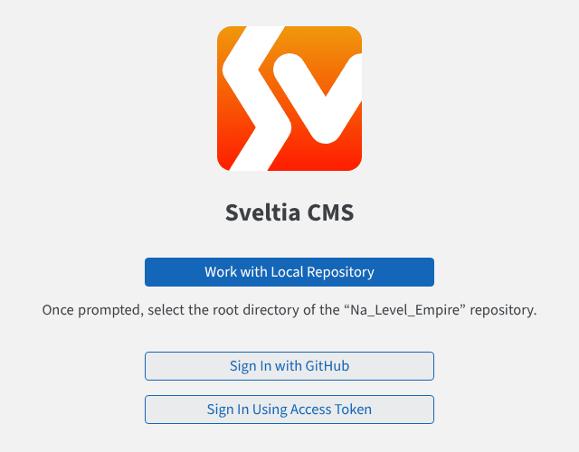

If GitHub sign-in is not working, the owner can give you a personal access
token instead: click **Sign In Using Access Token** and paste it
(instructions in `docs/setup-checklist.md`, "PAT fallback").

## 2. Find what you want to change

The left column lists everything you can edit. The number is how many items
each one has.

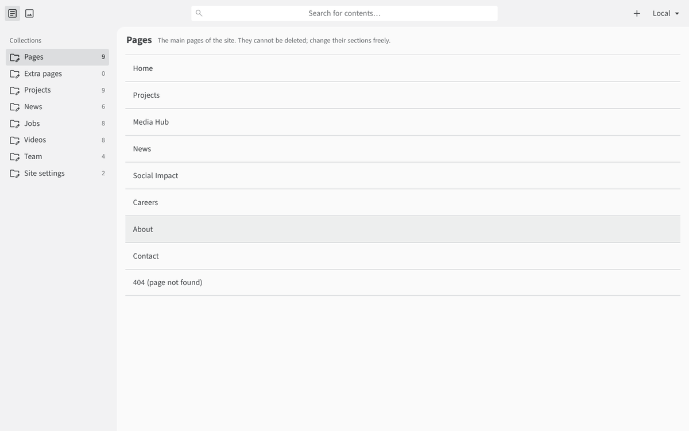

| Collection | What it holds |
| --- | --- |
| **Pages** | the 9 main pages (Home, Projects, Media Hub, News, Social Impact, Careers, About, Contact, 404). You can change their sections but not delete them. |
| **Extra pages** | pages you create yourself |
| **Projects / News / Jobs / Videos / Team** | the lists shown on the site |
| **Site settings** | site name, logo, menu, footer, contact details, social links, and **Interface text** (small labels such as "Target", "Skip to main content", email subjects) |

## 3. Edit a page: English and French side by side

Click a page. **English is on the left.** On the right you can switch
between **French** (to edit the French version) and **Preview**.

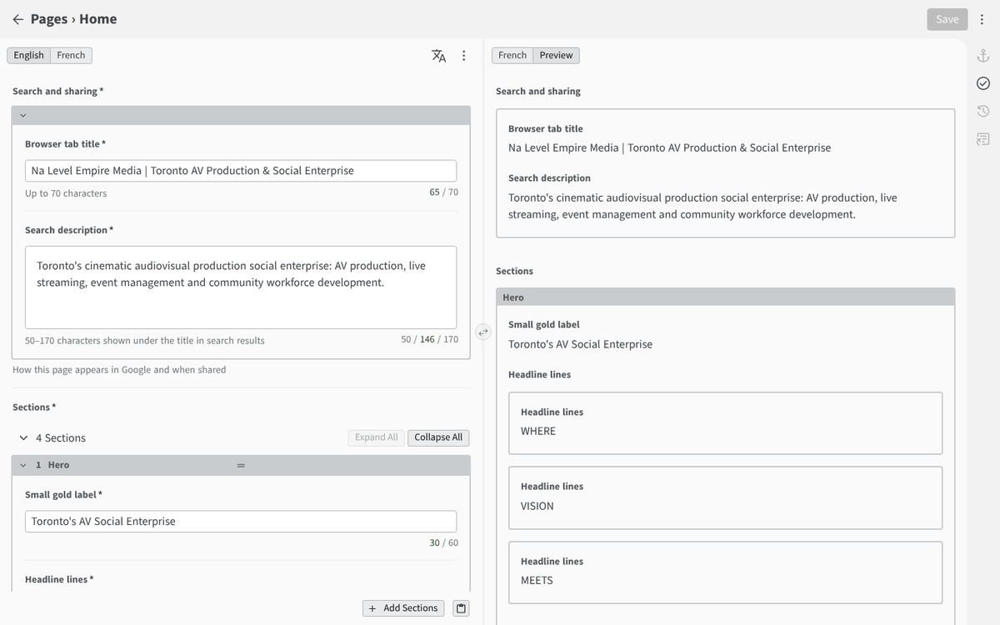

- **Search and sharing**: the title shown in the browser tab and in Google,
  and the short description shown under it (50–170 characters). These are
  also used when someone shares the page on social media.
- **Sections**: the blocks that make up the page, top to bottom.
- Character counters under each field turn red when text is too long.

> **Rule: English and French must have the same sections in the same
> order.** Only the words may differ. If you add, remove or move a section in
> English, do exactly the same in French before saving. Images, links and
> numbers are shared: change them once and both languages follow.

## 4. Reorder, remove, duplicate sections

Click **Collapse All** to see the list of sections. Hover over a section's
grey bar to show its controls:

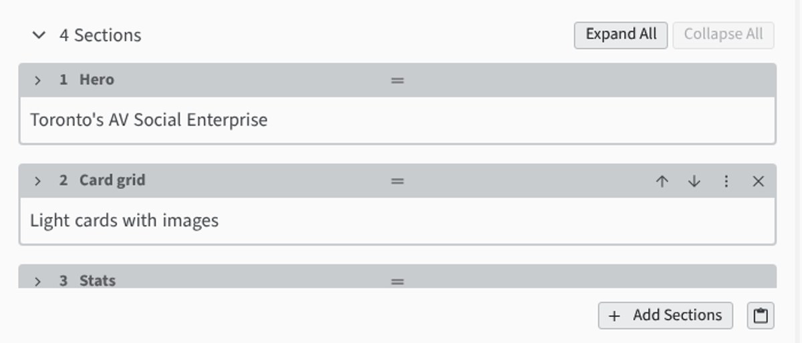

- **↑ / ↓** move the section up or down (or drag the **═** handle)
- **✕** removes the section
- **⋮** opens more options: duplicate, copy/paste between pages, move to
  top or bottom

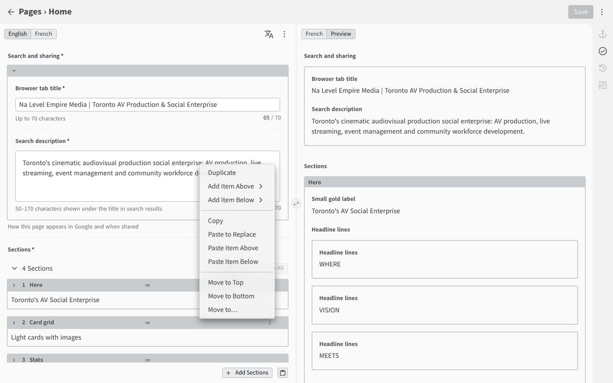

## 5. Add a section

Click **+ Add Sections** under the list and choose a type. It is added at the
bottom; move it where you want, then fill in its fields.

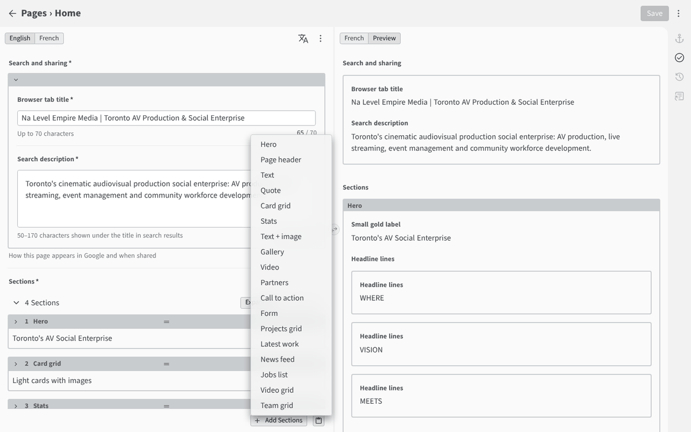

| Type | Use it for |
| --- | --- |
| Hero | big opening banner with headline, buttons, numbers and a scrolling photo strip (Home) |
| Page header | title band at the top of other pages |
| Text | paragraphs with an optional heading |
| Quote | a highlighted quotation |
| Card grid | services, values, perks: cards with icon or image |
| Stats | row of numbers; mark each one **Result** or **Target** |
| Text + image | text beside a photo |
| Gallery | grid of photos |
| Video | one embedded YouTube video |
| Partners | partner names/logos |
| Call to action | short message with buttons |
| Form | contact/quote form (messages go to levelempiremedia@gmail.com) |
| Projects grid / Latest work | lists from **Projects** |
| News feed | list from **News**, with categories |
| Jobs list | list from **Jobs** |
| Video grid | list from **Videos** |
| Team grid | list from **Team** |

## 6. Create a new page

Go to **Extra pages** → **New**.

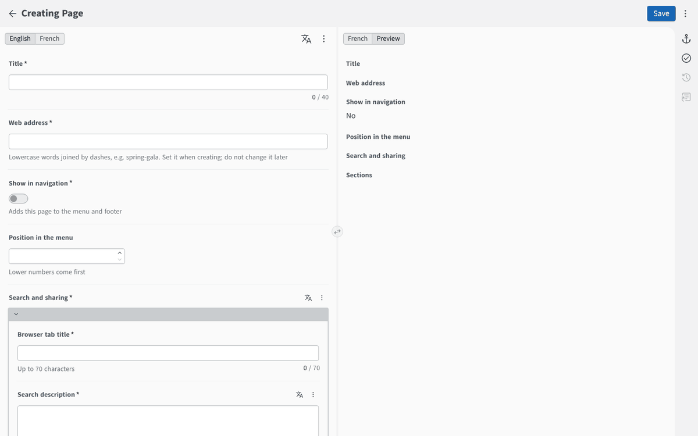

1. **Title**: the page name (also used as the menu label).
2. **Web address**: lowercase words joined by dashes, e.g. `spring-gala`.
   The page will be at `/spring-gala` and `/fr/spring-gala`. Choose it
   carefully: changing it later breaks links people saved.
   Some addresses are reserved (projects, media, news, impact, careers,
   about, contact, fr, en, admin, api, assets).
3. **Show in navigation**: switch on to add the page to the menu and footer
   automatically. **Position in the menu**: lower numbers come first.
4. Fill in **Search and sharing**, then add sections as in step 5.
5. Switch to **French** and fill in the same fields and sections.
6. **Save**.

To remove an extra page: open it, click **⋮** at the top right, **Delete**.

## 7. Projects, news, jobs, videos, team

Open the collection, click an item to edit it, or **New** to add one.

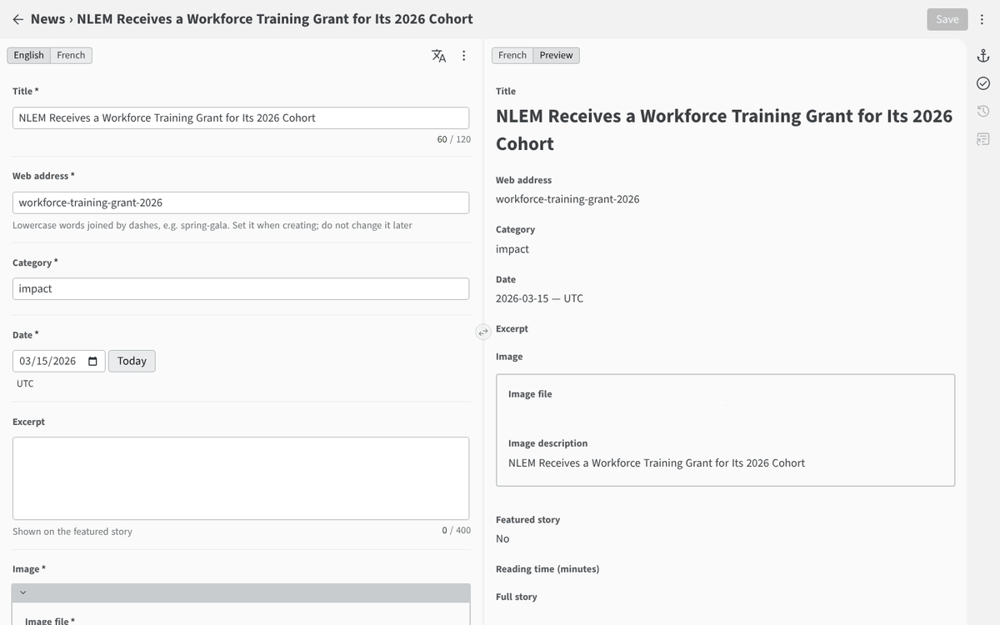

- **Web address** (news): set once when creating, then leave it.
- **Category** (news): one of `company`, `project`, `impact`, `industry`,
  `community`, `events`. The names visitors see are set on the News page
  (News feed section).
- **Featured story** (news): only one story can be featured.
- **Show on site**: switch off to hide an item without deleting it.
- **Placeholder (not confirmed yet)**: most content from the original
  prototype is marked as a placeholder. Switch it off once the information is
  confirmed. The full list is in `PLACEHOLDERS.md`.
- **Videos**: paste the YouTube link by hand.
- **Order** (projects, jobs, team): lower numbers come first.

## 8. Images

Every image has two parts:

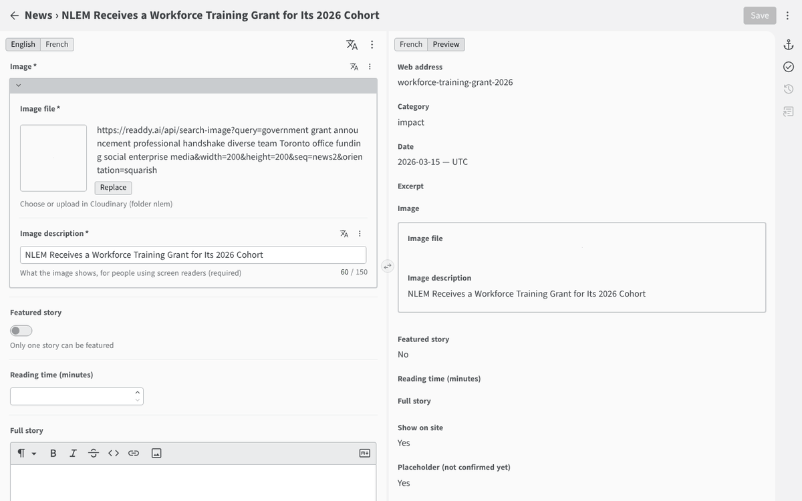

1. **Image file**: click **Replace** (or the select button on an empty field) to open Cloudinary,
   our image library. Sign in with your Cloudinary login, then pick an image
   or upload a new one **into the `nlem` folder**. The site only accepts
   images from that folder.
2. **Image description**: one sentence saying what the image shows, for
   people using screen readers. Required.

You do not need to resize images. The site automatically serves the right
size and format for each screen. Upload the best quality you have (JPEG or
PNG, ideally 2000 px wide or less).

## 9. Menu, footer, contact details, interface text

**Site settings → Site** holds the logo, menu links, the "Get a quote"
button, footer columns, contact details and social links.

**Site settings → Interface text** holds the small words around the site:
"Target", "Skip to main content", "min read", the subject line of emails sent by
the forms, and so on. Keep `{minutes}` and `{name}` exactly as they are:
the site replaces them with the real value.

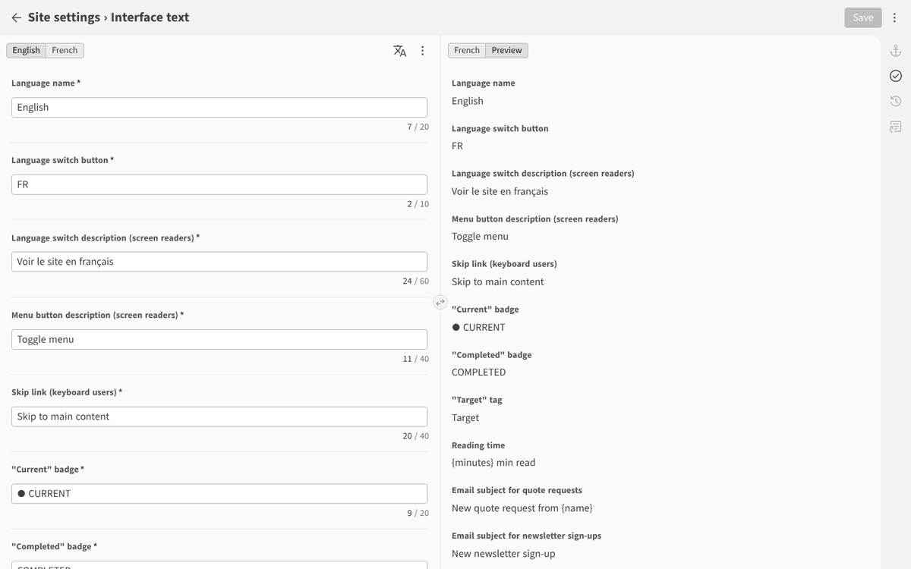

## 10. Saving, and if something goes wrong

- **Save** (top right) is blue when you have unsaved changes.
- If a field breaks a rule (empty required field, text too long), saving is
  blocked and the field is shown in red. The language tab with the problem
  gets a red mark too.

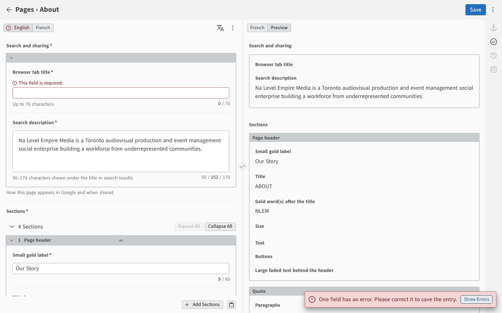

- A few rules are only checked when the site is rebuilt, for example
  "English and French have the same sections" or "only one featured story".
  If one fails, **the live site keeps the previous version** and your change
  does not appear. The owner sees a red **Error** in Vercel → Deployments
  with the exact problem in plain words, for example:
  *"pages/fr/about.json → sections: English and French must match (English
  has 4 item(s), this language has 3)"*. Fix it in the editor and save
  again.
- Every save is kept in history. Nothing is ever lost; the owner can restore
  any earlier version from GitHub.

Tips:

- Check the live page 2 minutes after saving.
- Make one change at a time; save often.
- `/admin` on a preview address (`…-jacques15.vercel.app`) still edits the
  **live** site.

---

## Adding an editor (owner only)

1. GitHub → the repository → **Settings → Collaborators → Add people** →
   their GitHub username, role **Write**.
2. Cloudinary → **Settings → Users → Invite user** (if your plan allows more
   users; otherwise share uploads through the owner), so they can upload images.
3. Send them this guide and the `/admin` address.

To remove an editor, remove them in both places.
